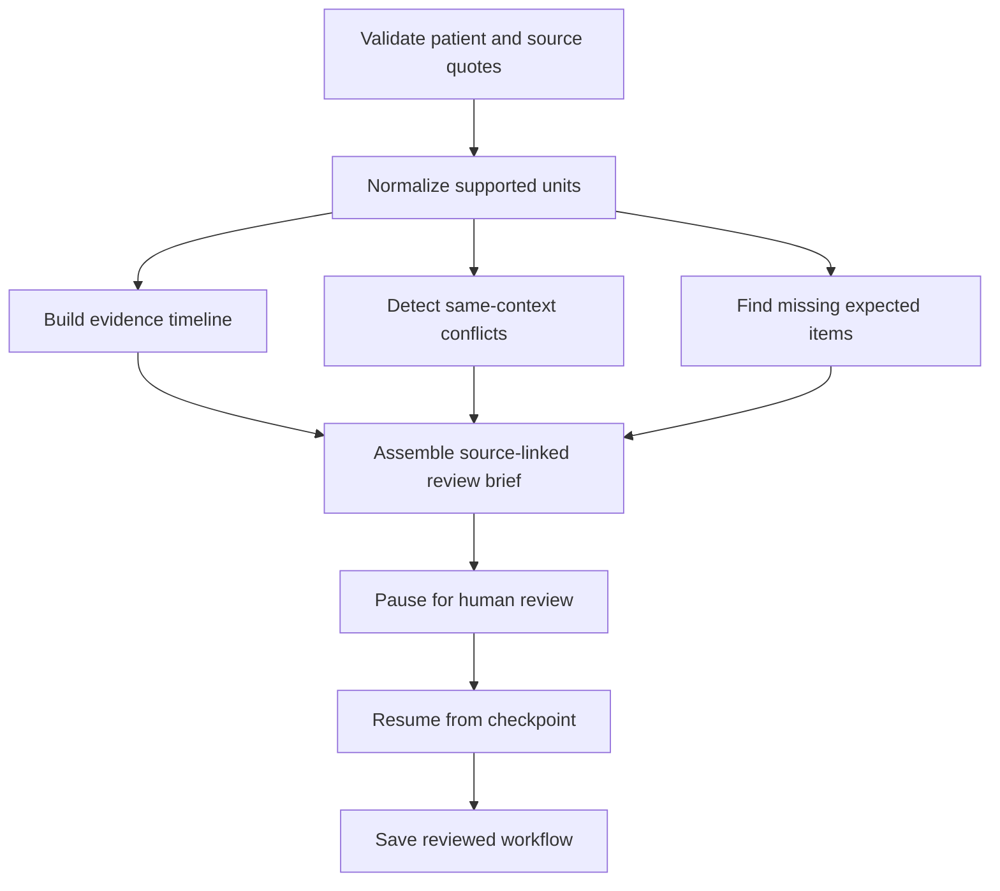
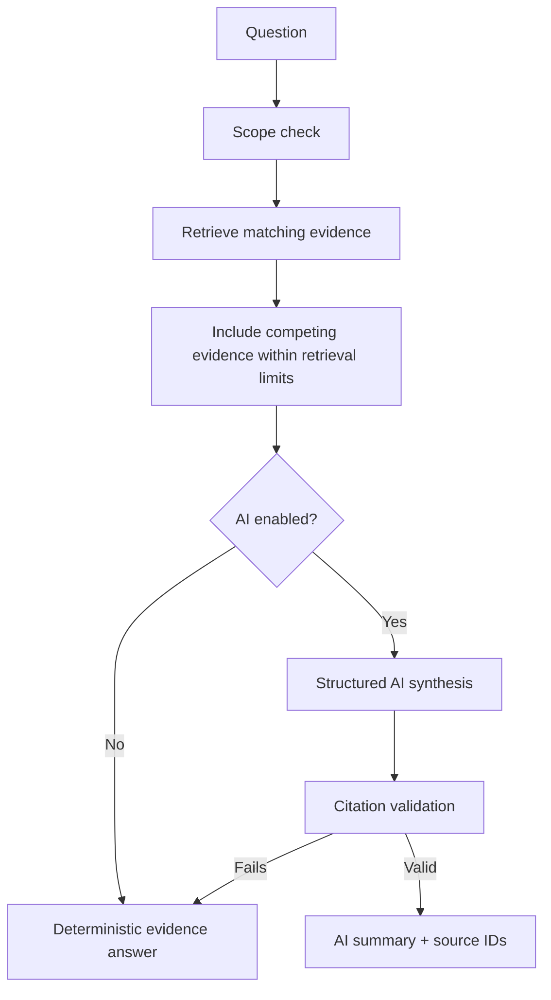
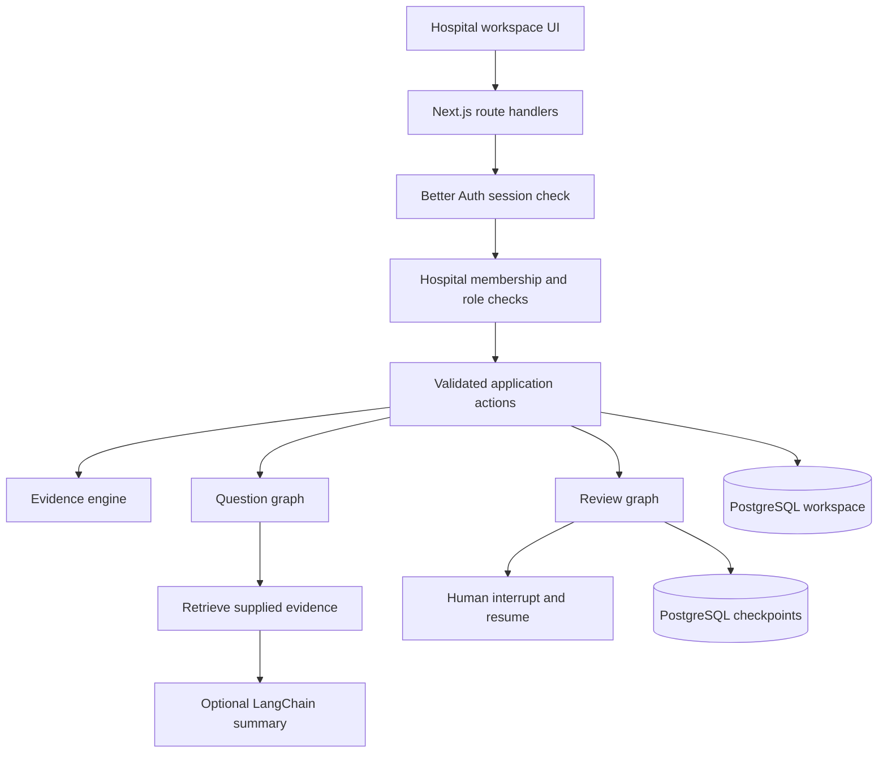

# Clinical Evidence Twin

> A shared workspace that helps a team understand records, compare conflicting information, and keep every review connected to its original source.

[Open the app](https://clinical-evidence-twin.vercel.app/) · [User guide](docs/USER_GUIDE.md) · [Setup guide](docs/DEPLOYMENT.md) · [Verification record](docs/VERIFICATION.md)

**Clinical Evidence Twin** is a working hospital-team pilot built with synthetic patient data. It brings records from different care teams into one evidence workspace, preserves the original source text, detects disagreements and missing information, builds a patient timeline, and lets a human reviewer document what they checked.

It is intentionally **not** a diagnosis engine, treatment recommender, prescribing tool, or autonomous clinical decision-maker.

> **Safety boundary:** this repository uses fictional demonstration records. Do not upload real patient records. The project does not claim HIPAA compliance, regulatory approval, clinical validation, or production readiness.

## Start with the part you need

| If you want to...                       | Start here                                                                                                    |
| --------------------------------------- | ------------------------------------------------------------------------------------------------------------- |
| Understand the problem and the solution | [Why I built this](#why-i-built-this) and [the problems it addresses](#the-real-problems-this-project-solves) |
| See a complete example                  | [Mira's case](#a-simple-example-mira-sen) and [the guided walkthrough](#try-the-product-step-by-step)         |
| Understand the technical terms          | [Plain-English definitions](#the-main-terms-in-plain-english)                                                 |
| Run the application                     | [Local setup](#running-locally) and [account setup](#enabling-accounts-and-saved-hospital-workspaces)         |
| Add a sample record                     | [JSON example and input rules](#adding-a-record-example-and-input-rules)                                      |
| Check what is working and what remains  | [Verified status](#verified-status-and-remaining-setup) and [current limitations](#current-limitations)       |

---

## Why I built this

The hard part of reviewing a patient record is often not that information is completely unavailable. The harder problem is that the information is **spread across places, recorded at different times, written in different formats, and sometimes contradictory**.

Imagine a reviewer receives records from a clinic, a hospital, and a specialty centre.

One note says:

- Penicillin allergy — rash reported.

Another note for the same care episode says:

- No known drug allergies.

A discharge summary says:

- Medication A was held pending review.

A later medication list says:

- Medication A should continue.

One record says a procedure happened on 18 July. Another says 19 July.

The discharge note requests a follow-up, but no confirmed follow-up date exists in the supplied record set.

A normal search box can find these sentences, but it does not solve the actual review problem. A reviewer still needs to know:

1. Which statements refer to the **same event or context**?
2. Which records genuinely disagree?
3. Which values are actually equivalent but use different units?
4. Which expected items are missing from the supplied records?
5. Where did every displayed statement come from?
6. Has a human already reviewed the disagreement?
7. Did new evidence arrive after an earlier review?
8. Can AI summarize the evidence without hiding a conflicting source?

That is the problem this project is designed around.

The solution I built is a single workspace where the team can see the timeline, open the source behind a statement, compare differences, and record its reasoning. The intended benefit is a clearer handover: the next reviewer can see what was checked and what remains uncertain. This pilot has not measured hospital time savings or patient outcomes.

---

## What “Evidence Twin” means here

The word **twin** does not mean that the application simulates a patient’s biology or predicts what will happen to them.

In this project, the twin is a **structured, source-linked representation of the supplied record set**.

The system keeps:

- the original source record,
- the exact quoted evidence,
- the date the clinical event happened,
- the date the source was recorded,
- the structured meaning of each claim,
- normalized measurements where conversion is explicitly supported,
- detected conflicts,
- missing expected information,
- reviewer decisions,
- workflow history,
- and source-linked question answers.

So the goal is not:

> “Ask AI what is medically true.”

The goal is:

> “Make it much easier for a human reviewer to see what the supplied records say, where they disagree, what is missing, and exactly which sources support each statement.”

---

## The real problems this project solves

### 1. Fragmented records from multiple care teams

A patient story can be split across visit notes, discharge summaries, medication lists, referrals, and measurement sheets.

Clinical Evidence Twin puts those sources into one patient workspace while keeping every source intact.

The reviewer can move between:

- **Overview**
- **Patient timeline**
- **Source records**
- **Needs review**
- **Saved memory**
- **Evidence workflow**
- **Ask the evidence**

The application does not replace the original record with a generated summary. The original source remains available and each extracted statement points back to it.

---

### 2. Conflicting statements

Two records can describe the same situation differently.

The system groups evidence only when the structured key **and the event context** match. If the normalized values differ, it creates a review issue.

For example:

- Allergy history in the July care episode: “Penicillin — rash reported”
- Allergy history in the same July care episode: “No known drug allergies”

The application keeps **both** statements visible.

It does not automatically decide that:

- the newer record is correct,
- the hospital record is more trustworthy,
- or the AI-generated interpretation should win.

That decision stays with the human reviewer.

---

### 3. False conflicts caused by units

Different systems may represent the same measurement differently.

For example:

- 62 kg
- 62000 g

or:

- 168 cm
- 1.68 m

Clinical Evidence Twin currently supports explicit normalization for:

- grams → kilograms
- metres → centimetres

The normalized values can be compared while the **original values and units are preserved**.

Unsupported units are not guessed.

This prevents equivalent measurements from being incorrectly presented as contradictions.

---

### 4. Event date versus record-entry date

A note can be entered later than the event it describes.

That distinction matters.

The system therefore preserves both:

- **effectiveAt** — when the event or statement applies
- **recordedAt** — when the source record was entered

The timeline is built around the clinical event date instead of silently treating the file-entry date as the event date.

---

### 5. Missing information

Sometimes the most important observation is not a contradiction but a gap.

For the fictional Mira Sen case, the discharge note asks for a follow-up but no confirmed follow-up date is present in the supplied source set.

The project detects this as:

> “Follow-up date is missing.”

Importantly, the application does **not** say:

> “The patient has no follow-up.”

It says the information is absent **from the supplied records**.

That distinction avoids turning missing evidence into a false clinical claim.

---

### 6. AI summaries that can hide uncertainty

A normal LLM can produce a fluent answer while accidentally:

- dropping one side of a disagreement,
- citing an unknown source,
- sounding more certain than the evidence,
- or turning a summary into an implied recommendation.

This project uses a different approach.

The default mode is deterministic **Evidence search**.

Optional AI synthesis is allowed only after evidence retrieval. The model is instructed to answer from the supplied evidence and return structured statements with source IDs.

After generation, the application validates the result.

If:

- an unknown source is cited, or
- one side of a detected conflict is omitted,

the AI answer is rejected and the system falls back to the original deterministic evidence.

AI-written text is also **never automatically promoted into patient memory**.

---

### 7. Human review must remain in the loop

The main evidence workflow is implemented as a real LangGraph StateGraph.

The workflow:



The graph deliberately stops before finalization.

A reviewer must provide a valid approval response before the workflow can continue.

The implementation uses:

- parallel LangGraph branches,
- a join before brief assembly,
- a typed human interrupt,
- thread-scoped checkpoints,
- and Command resume.

Completing the overall workflow does **not** silently resolve individual evidence disagreements. Those review items keep their own status.

---

## A simple example: Mira Sen

The repository includes three fictional cases. Mira Sen is the clearest end-to-end example.

Her synthetic record set intentionally contains:

1. **Allergy disagreement**
   - Penicillin rash reported
   - No known drug allergies

2. **Medication disagreement**
   - Medication A held pending review
   - Medication A continue

3. **Procedure-date disagreement**
   - 18 July 2026
   - 19 July 2026

4. **Missing follow-up date**
   - A follow-up is requested
   - No confirmed date exists in the supplied records

The evidence engine produces those review items without inventing which source is clinically correct.

A reviewer can open each source, compare the exact quotes, write a note, keep the issue open or document a source choice, and preserve that reasoning for the next reviewer.

---

## Try the product step by step

### 1. Explore the public demo

Open the [app](https://clinical-evidence-twin.vercel.app/) and choose **Explore the demo**. Select **Mira Sen**, open **Needs review**, and click the source labels to read the original text.

No account is needed for this part. You can ask about the sample evidence and export a brief. The public demo is read-only; saving reviews, importing records, and running review workflows require an authorized hospital account.

### 2. Create your pilot workspace

Choose **Create workspace**. Enter your name, email, and a password of at least 12 characters. Then choose **Create a hospital**, enter the team name and department, and open it from **My hospitals**.

Each hospital starts with its own copy of the three fictional cases. Creating a workspace does not verify that the organization is a licensed hospital. If the account screen says setup is incomplete, the deployment owner must finish the database and authentication configuration first.

### 3. Save your first review

1. Open Mira's case and follow **What to do next**.
2. Open the allergy-history disagreement in **Needs review**.
3. Read both cited records.
4. Choose **Keep it open** and write what needs confirmation. For example: “The two records disagree. The original allergy history needs confirmation.”
5. Select **Save review**. The server attaches your account as the author.

You have now saved a useful review note without claiming that the disagreement has been resolved. Marking an issue as reviewed records the review activity; it does not prove that a statement is clinically true.

### 4. Ask about the record set

Try **Which records disagree?** or **What weight is recorded?** in **Ask the evidence**. Open the source chips in the answer.

The label tells you how the answer was produced: **Evidence search** displays recorded statements; **AI summary** means an optional model wrote a summary from retrieved evidence. Public demo questions always use evidence search.

### 5. Run the evidence workflow

Select **Evidence workflow**, then **Run evidence checks**. Read the results and the review brief. The workflow pauses until a reviewer selects **Review this brief** and saves a valid note.

Completing the workflow does not automatically close individual disagreements. Those items still need their own documented review.

### 6. Add a new record

Choose **Add record**, then **Try a sample record**. The built-in sample supplies a fictional follow-up date. Read the preview and import it.

The missing-date check updates. The earlier workflow still describes its original sources, so run the checks again for the changed record set.

### 7. Export and sign out

Select **Export brief** to download a readable Markdown brief or JSON evidence bundle. Refresh to check that your hospital's saved review remains. When finished, use **Sign out** to invalidate the current session on the server.

For a colleague to join, the owner shares the hospital code. The colleague submits an access request; the owner confirms their identity outside the app before approving a role. No invitation email is sent automatically.

---

## The main terms in plain English

| Term              | What it means here                                                                             |
| ----------------- | ---------------------------------------------------------------------------------------------- |
| Evidence          | A recorded statement with a source you can open and inspect                                    |
| Provenance        | The history of where a statement came from: source, quote, dates, and review links             |
| Longitudinal      | Following information over time rather than reading every document in isolation                |
| Context           | The event or episode a statement refers to, supplied in the structured input                   |
| Normalization     | Converting supported values into a consistent form for comparison                              |
| Human-in-the-loop | A workflow that requires a person's review before it can continue                              |
| Checkpoint        | A saved workflow state that can be loaded later                                                |
| Thread            | The identifier for one workflow execution and its checkpoints                                  |
| Tenant            | One hospital workspace whose data and access are separated from other hospitals                |
| Authentication    | Checking which account is signed in                                                            |
| Authorization     | Checking what that account is allowed to do in a particular hospital                           |
| MCP               | Model Context Protocol: a standard way for a compatible client to call the application's tools |

The LangGraph nodes have fixed responsibilities. Validation, unit conversion, timeline construction, and conflict checks use ordinary code. They are not separate autonomous medical agents making decisions. LangChain is used for optional summaries after evidence retrieval.

---

## How the application works, step by step

### Step 1 — Load a patient workspace

The user opens a fictional patient case.

The workspace loads:

- source records,
- previous decisions,
- workflow runs,
- audit events,
- and saved evidence answers.

Hospital workspaces use PostgreSQL. The public demo always uses isolated read-only seed data.

---

### Step 2 — Validate the records

Before evidence is analyzed, the application validates each record.

Checks include:

- exact patient ID match,
- valid calendar dates,
- unique record IDs,
- unique claim IDs,
- valid date ranges,
- and exact evidence quote validation.

Every evidence excerpt must literally exist inside the source text.

If the quote does not exist, the record is rejected.

This prevents the application from attaching a source citation to text that was never actually present in that source.

---

### Step 3 — Normalize only supported measurements

The evidence engine normalizes supported units for comparison.

Examples:

- 74000 g → 74 kg
- 1.68 m → 168 cm

The original measurement is still retained.

The code intentionally avoids a broad “smart” conversion layer. Unsupported units remain unchanged instead of being guessed.

---

### Step 4 — Build the patient timeline

Evidence is grouped by the event’s effective date.

This helps a reviewer see the story in chronological clinical order while still retaining the separate source-entry date.

The current timeline shows the newest event date first. A note's entry date stays attached as separate source information.

---

### Step 5 — Detect disagreements

Evidence is grouped by:

**structured key + event context**

Only statements describing the same structured concept in the same context are compared as potential conflicts.

This is important because:

- a weight measured at one visit,
- and a different weight measured weeks later,

should usually be treated as a time series, not automatically as a contradiction.

---

### Step 6 — Detect missing expected information

Each fictional patient can define expected items.

If no evidence with that key exists, the system creates a missing-information review item.

Again, the wording stays scoped to the supplied record set.

---

### Step 7 — Keep the source one click away

Every important statement carries provenance such as:

- source ID,
- source title,
- organization,
- exact excerpt,
- event date,
- record-entry date.

The UI can open the original source and highlight the evidence being discussed.

---

### Step 8 — Let the reviewer document reasoning

For a disagreement, a reviewer can:

- keep the issue open,
- document the review,
- or select one of the already-cited statements.

A selected statement must actually belong to the issue. The API rejects an arbitrary claim ID.

The original competing sources are never overwritten.

---

### Step 9 — Ask questions about the evidence

The question workflow is also a LangGraph pipeline:



The scope step uses a limited phrase check to redirect certain diagnosis, prescription, dosage, and treatment-change questions. It is not a comprehensive clinical safety classifier. The model prompt also restricts answers to describing the supplied records.

If the supplied records cannot answer a question, the system says so rather than inventing evidence.

---

## Hospital workspace and team access

The project is more than a single-user demo.

When PostgreSQL and Better Auth are configured, users can create accounts and work inside hospital-scoped workspaces.

### Roles

| Role         | Access                                                                                    |
| ------------ | ----------------------------------------------------------------------------------------- |
| **Owner**    | Review cases, export, approve teammates, change roles, remove access, view access history |
| **Reviewer** | Read evidence, add synthetic records, ask questions, save decisions, run workflows        |
| **Viewer**   | Read evidence and export a brief, but cannot save changes                                 |

A hospital code does **not** immediately grant access.

The flow is:

1. A user signs in.
2. They enter a hospital code.
3. A pending access request is created.
4. The hospital owner reviews the request.
5. The owner assigns viewer or reviewer access.
6. Only then can the user enter that hospital workspace.

The requested hospital ID is never trusted by itself. Protected server routes verify the signed-in user’s membership before reading or changing workspace data.

---

## Security and consistency choices

This repository intentionally contains several engineering guardrails that are easy to miss from the UI.

#### Server-derived identity

Review authorship is taken from the authenticated account on the server.

A browser cannot submit:

> “Senior Clinician”

and override the signed-in account's stored name through the review request. However, account names are self-entered. This protection links a review to an account; it does not verify the person's qualifications or clinical identity.

#### Session-backed authorization

Protected requests use Better Auth database sessions.

Session cookie caching is disabled so sign-out or revocation takes effect on following requests instead of continuing from a stale cached session.

#### Server-side permission checks

Viewer restrictions are not only hidden in the UI.

The API independently checks owner / reviewer / viewer permissions.

#### Cross-site write protection

Browser mutations require a matching request Origin.

#### Revision checks

Every workspace contains a revision number.

A stale browser tab cannot silently overwrite a newer change. The write is rejected and the client can refresh.

#### Database locking

Workspace mutations use a row lock while checking the revision.

Role changes and revocation are also designed to serialize against relevant in-flight writes.

#### Append-only source behavior

Original source records are not overwritten through the application flow.

New records are appended and previous source text remains available.

#### Source-set fingerprinting

A workflow run stores a fingerprint of the evidence set it reviewed.

If a new record is added after the workflow paused, the old run cannot simply be approved as though it had reviewed the new evidence.

A new evidence review is required.

---

## Public demo versus hospital workspace

### Public demo

- no account required,
- fixed fictional records,
- read-only,
- source search works,
- no hospital data access,
- AI model calls are disabled,
- reviews and workflow changes are not saved.

### Signed-in hospital workspace

With PostgreSQL and Better Auth configured:

- hospital-scoped copies of the fictional cases,
- saved reviewer decisions,
- imports of structured synthetic records,
- LangGraph workflow checkpoints,
- account and membership management,
- access history,
- export,
- and optional AI summaries.

---

## Main product views

#### Overview

Shows record coverage, open review items, and the next things a reviewer should check.

#### Patient timeline

Organizes evidence by event date while preserving source metadata.

#### Source records

Displays original source text instead of only showing generated summaries.

#### Needs review

Surfaces contradictions and missing information with the competing evidence beside the issue.

#### Saved memory

Shows source-linked statements and whether they are:

- Source recorded
- Needs review
- Reviewer selected

This “memory” is evidence-derived. AI output is not silently stored as factual memory.

This is structured evidence memory and review history. Vector embeddings, a semantic memory service, and a temporal knowledge-graph database are not implemented.

#### Evidence workflow

Runs validation, normalization, timeline building, conflict checks, missing-item checks, brief assembly, then pauses for human review.

#### Ask the evidence

Retrieves source-linked statements and optionally uses an AI model for constrained synthesis.

---

## Technical architecture



This diagram shows the protected hospital path. The public demo reads fixed seed records through its own read-only flow. MCP is a separate read-only integration with an explicitly configured access scope.

---

## Project structure

| Location                                                    | Responsibility                                                             |
| ----------------------------------------------------------- | -------------------------------------------------------------------------- |
| `app/`                                                      | Pages, account screens, hospital hub, and API routes                       |
| `app/components/`                                           | Source viewers, review forms, imports, questions, and workspace UI         |
| `data/patients.ts`                                          | The three fictional cases and their original records                       |
| `lib/types.ts`                                              | Data shapes and input validation                                           |
| `lib/evidence.ts`                                           | Unit normalization, timelines, conflicts, missing items, and source search |
| `lib/workflow.ts`                                           | Review graph, checkpointing, and human pause/resume                        |
| `lib/questions.ts` and `lib/ai.ts`                          | Question graph, optional model adapters, and citation fallback             |
| `lib/auth.ts`, `lib/hospitals.ts`, and `lib/permissions.ts` | Sessions, membership, owner approval, and role enforcement                 |
| `lib/store.ts`, `lib/schema.ts`, and `lib/service.ts`       | Persistence, database schema, revision checks, and validated actions       |
| `mcp/`                                                      | Read-only MCP server and tools                                             |
| `scripts/migrate.ts`                                        | Repeatable account, hospital, and checkpoint table preparation             |
| `tests/`                                                    | Evidence, workflow, storage, access, authentication, and MCP checks        |
| `docs/`                                                     | User guide, architecture, deployment, safety, and verification notes       |
| `vercel.json`                                               | Deployment build command                                                   |

Start with one record in `data/patients.ts`, follow its claims through `lib/evidence.ts`, then read `lib/workflow.ts`. This connects a visible example to the implementation before you move into authentication and storage.

---

## Tech stack

| Area                     | Technology                                           |
| ------------------------ | ---------------------------------------------------- |
| Frontend                 | Next.js 16, React 19, TypeScript                     |
| Validation               | Zod                                                  |
| Workflow orchestration   | LangGraph                                            |
| AI abstraction           | LangChain                                            |
| Optional model providers | Google Gemini or OpenAI-compatible Vercel AI Gateway |
| Authentication           | Better Auth                                          |
| Database                 | PostgreSQL                                           |
| Workflow checkpointing   | LangGraph PostgreSQL checkpointer                    |
| Testing database         | PGlite embedded PostgreSQL                           |
| MCP                      | Model Context Protocol SDK                           |
| Deployment               | Vercel                                               |
| Styling                  | Application CSS + DM Sans / Manrope fonts            |

---

## Deterministic-first AI design

One of the main design decisions in this project is that **AI is optional**.

The application remains useful with no model API key.

Without AI:

- evidence validation works,
- normalization works,
- timeline construction works,
- conflict detection works,
- missing-item checks work,
- workflows work,
- source search works.

When AI is enabled, it is used as a **constrained summarization layer**, not as the source of truth.

The system sends only retrieved evidence to the model and asks for structured statements with source IDs.

Then application code performs its own checks.

This makes the model an optional assistant sitting **after retrieval**, rather than the mechanism that defines the patient evidence.

Retrieval is bounded to a limited set of statements, including up to 30 statements after expanding matching contexts. A source-ID check can catch an unknown citation, but it cannot prove that every generated sentence follows correctly from the cited words. Source review is still required.

The pilot uses a model-output limit, timeouts, question-frequency limits, and a shared daily allowance of 100 synthesis attempts by default. Failed attempts count toward the allowance, and a provider retry may occur within an attempt. This is not a currency budget; provider spending controls need separate configuration. Public demo questions never call a model.

---

## MCP integration

The repository includes five read-only MCP tools:

1. **list_synthetic_cases**
2. **get_evidence_timeline**
3. **search_evidence**
4. **list_review_items**
5. **read_source**

Run the stdio server with:

```bash
npm run mcp
```

The tools are intentionally read-only.

They cannot:

- edit a source,
- prescribe,
- resolve a disagreement,
- or make a clinical decision.

Hosted MCP requires a bearer token. Hospital workspace access is additionally disabled unless it is explicitly enabled and a specific workspace ID is configured.

This is a server-configured integration credential, not per-user MCP OAuth. See [MCP setup](docs/MCP.md) for details.

---

## Running locally

### Requirements

- Node.js 24 LTS
- npm

Clone the repository and install dependencies:

```bash
git clone https://github.com/Sankalp-gupta1/clinical-evidence-twin.git
cd clinical-evidence-twin
npm ci
```

Start the public read-only demo:

```bash
npm run dev
```

Open:

```text
http://localhost:3000
```

The demo does not require a paid AI API.

---

## Enabling accounts and saved hospital workspaces

For account-backed workspaces, create a dedicated development PostgreSQL database and configure Better Auth in **.env.local**.

Copy the example file first.

**Windows PowerShell:**

```powershell
Copy-Item .env.example .env.local
```

**macOS or Linux:**

```bash
cp .env.example .env.local
```

Edit `.env.local` locally. The example account variables are commented out: remove the leading `#` from the lines you configure and replace the placeholders with your own values.

Core variables:

```text
DATABASE_URL=...
DATABASE_URL_UNPOOLED=...
BETTER_AUTH_SECRET=...
BETTER_AUTH_URL=http://localhost:3000
```

`DATABASE_URL` is the runtime connection. When using Neon pooling, `DATABASE_URL_UNPOOLED` is the direct connection used for migration locking. `BETTER_AUTH_SECRET` must be a freshly generated secret with at least 32 random bytes, not an account password or a sample value.

Run the migration:

```bash
node --env-file=.env.local --import tsx scripts/migrate.ts
```

Next.js loads `.env.local` for the application. The explicit `--env-file` above makes it available to the standalone migration script too. The shorthand `npm run db:migrate` expects the variables to already be available in the process environment.

Then restart:

```bash
npm run dev
```

Optional integrations include:

- account verification / password reset email,
- Gemini,
- Vercel AI Gateway,
- hosted MCP.

See [.env.example](.env.example) and [Deployment](docs/DEPLOYMENT.md) for the complete configuration.

Never commit real secrets to the repository.

---

## Adding a record: example and input rules

The importer accepts one structured fictional JSON source at a time. Save this example as `mira-followup.json` and import it into Mira's case using an Owner or Reviewer account:

```json
{
  "id": "MS-README-07",
  "patientId": "demo-mira",
  "title": "Confirmed follow-up appointment",
  "organization": "Synthetic Demo Clinic",
  "recordedAt": "2026-08-26",
  "type": "Visit note",
  "synthetic": true,
  "text": "SYNTHETIC RECORD — not a real patient.\nPatient ID: demo-mira\nFollow-up appointment: 1 September 2026.",
  "claims": [
    {
      "id": "ms-readme-followup-1",
      "key": "followup.date",
      "label": "Follow-up appointment",
      "value": "2026-09-01",
      "kind": "event",
      "context": "confirmed-followup",
      "effectiveAt": "2026-09-01",
      "excerpt": "Follow-up appointment: 1 September 2026."
    }
  ]
}
```

After importing this record, Mira's missing follow-up-date item should disappear because evidence with the required `followup.date` key is now present. Existing disagreements remain. Run the evidence workflow again to review the expanded source set.

| Input rule                                                     | Why it matters                                                           |
| -------------------------------------------------------------- | ------------------------------------------------------------------------ |
| The patient ID must match the open case                        | A record for another patient is rejected                                 |
| Record IDs and claim IDs must be unique in their checked scope | An import cannot replace an existing source or ambiguously reuse a claim |
| The excerpt must exist exactly in the original text            | A citation can be traced to the supplied words                           |
| Dates must be valid `YYYY-MM-DD` calendar dates                | Invalid dates cannot silently enter the timeline                         |
| `validUntil`, when supplied, must not precede `effectiveAt`    | The statement's date range must be consistent                            |
| Browser upload size is at most 90,000 bytes                    | Imports stay bounded for this pilot                                      |
| A source has at most 24,000 text characters and 50 claims      | One import cannot expand without a limit                                 |
| A hospital workspace supports at most 60 records               | The current JSON workspace stays small enough for the pilot              |
| `synthetic` must be `true`                                     | The format explicitly declares fictional input                           |

Use fresh record and claim IDs when importing another example. The `synthetic` flag is a declaration, not a detector of real patient information. Quote matching also checks traceability, not whether a statement has been interpreted correctly.

The full field definitions and constraints are in [lib/types.ts](lib/types.ts). The **Add record** dialog also provides a downloadable template.

---

## Useful commands

```bash
npm run dev
npm run build
npm start
npm test
npm run typecheck
npm run check
npm run db:migrate
npm run mcp
```

**npm run check** performs:

1. TypeScript type checking
2. automated tests
3. production build

---

## What is tested

The repository contains tests for the parts that should not rely on visual inspection alone.

Examples include:

- Mira’s three planted contradictory contexts are detected.
- Her missing follow-up item is detected.
- Equivalent units do not create false conflicts.
- Original measurements remain unchanged.
- Unsupported unit conversions are not guessed.
- Patient data cannot cross an exact patient-ID boundary.
- Invalid evidence quotes are rejected.
- Duplicate record and claim IDs are rejected.
- Invalid calendar dates are rejected.
- Measurements at different visits are not automatically treated as contradictions.
- A review cannot select a statement outside the issue’s cited evidence.
- Keeping an issue open does not silently resolve it.
- Evidence questions include every competing side of a retrieved disagreement.
- Unanswerable questions do not invent a source.
- Direct treatment requests are blocked from becoming clinical recommendations.
- The real LangGraph pauses at human review and resumes from its checkpoint.
- Separate workflow threads do not expose each other’s state.
- PostgreSQL hospital authorization is tested with real database behavior using PGlite.
- Viewer writes are rejected by the server.
- Review authorship cannot be spoofed from the browser.
- Hospital workspaces remain isolated.
- Stale revisions are rejected.
- Revoked access stops future workspace reads.
- Public demo requests remain separated from hospital data.
- Sign-out invalidates the old database session.

Run:

```bash
npm test
npm run typecheck
npm run build
```

---

## Verified status and remaining setup

The implementation, automated tests, and hosted checks are different kinds of evidence. A successful deployment alone does not prove that every hospital workflow works in a live browser.

| Area                                          | Recorded status                                                                                                                                |
| --------------------------------------------- | ---------------------------------------------------------------------------------------------------------------------------------------------- |
| Evidence, workflow, account, and access tests | The earlier full suite passed 29 checks. After adding a migration check, the focused account suite passed 11 checks. These were separate runs. |
| TypeScript and production build               | Passed for the application release                                                                                                             |
| Hosted database preparation                   | The production build for `7714e47` on 9 October 2026 confirmed that account, hospital, source-storage, and checkpoint tables were ready        |
| Documentation release observed                | GitHub's Vercel check for `dfcc700` reported success when checked on 11 October 2026                                                           |
| Public browser flow                           | Earlier checks covered the landing page, source-linked questions, original source views, and read-only controls                                |
| Complete hosted account journey               | Still needs a live sign-up → hospital creation → saved review → refresh → sign-out check                                                       |
| Live AI summaries                             | Adapters are implemented; provider configuration and a live model response still need verification                                             |
| Email verification and recovery               | Optional provider integration is implemented; live delivery has not been verified                                                              |
| Hosted authenticated MCP                      | Local SDK handshake is tested; a live authenticated hosted client still needs verification                                                     |

The latest attempted live-app browser check was blocked in the checking environment. It did not establish that the application was unavailable to other users. The dated details are maintained in [docs/VERIFICATION.md](docs/VERIFICATION.md).

On Vercel, the configured build runs database preparation before the application build. Runtime traffic uses the pooled database URL; migrations prefer the direct Neon URL for session locking. Missing account configuration leaves a labeled read-only preview. A configured migration failure stops the build.

---

## Data model philosophy

The application deliberately separates several concepts that are often collapsed together.

#### Source

The original synthetic record.

#### Claim

A structured statement extracted from that source.

#### Evidence

A claim combined with its source provenance and normalized comparison value.

#### Issue

A conflict or missing expected item that needs review.

#### Decision

A human reviewer’s recorded reasoning about an issue.

#### Memory

A source-linked view of evidence and its review state.

#### Workflow run

A specific evidence set processed by the LangGraph review workflow.

#### Audit event

A record of significant actions in the workspace.

That separation allows the application to preserve history instead of replacing the old record with a single “current truth” field.

---

## Important engineering decisions

#### Exact patient matching

There is no fuzzy patient matching.

A similar name is not enough to merge records.

#### Context-aware comparisons

Two claims are compared only when their structured key and context match.

#### Original records are preserved

A newly imported record does not rewrite an older source.

#### New evidence invalidates old workflow approval

The source fingerprint changes when the evidence set changes.

#### Missing evidence is not treated as negative evidence

“No follow-up date appears in these records” is different from “there is no follow-up.”

#### AI cannot create factual memory automatically

Generated text remains generated text.

#### Human review does not rewrite history

Reviewer decisions are stored alongside the source evidence.

---

## Current limitations

This is an engineering pilot, not a production clinical system.

Not currently implemented:

- real EHR integration,
- FHIR ingestion,
- arbitrary PDF / OCR extraction,
- medical terminology services,
- external clinical-reference retrieval,
- enterprise SSO,
- MFA,
- clinical credential verification,
- database row-level security,
- formal penetration testing,
- automated retention policy,
- billing,
- regulatory certification,
- automated PHI detection,
- clinician-validated factuality evaluation,
- exactly-once distributed workflow recovery.

The structured importer accepts only synthetic records that follow the defined schema.

The current lexical evidence search is deliberately bounded and does not use embeddings.

The pilot stores each hospital's bounded evidence workspace as a JSON document in PostgreSQL. It supports up to 60 records and 20 team members per hospital; it is not a fully normalized EHR database. Checkpoints and application writes happen separately, so a failure between them can require a new workflow run. A durable worker and reconciliation process are future work.

Password recovery and verification require a configured email provider. A hospital owner cannot view or reset another user's password. No real patient information should be used to test this pilot.

---

## Explain the project in a minute

> I built Clinical Evidence Twin to make a changing collection of records easier to review. It keeps the original sources, separates event dates from note-entry dates, highlights conflicting statements, and lets a reviewer save their reasoning. LangGraph manages the checks and pauses for human review. PostgreSQL stores each hospital's work and workflow checkpoints. LangChain supports optional source-linked summaries, and MCP exposes read-only evidence tools. The current version uses fictional data and helps organize evidence for review.

---

## What I would build next

If this project moved beyond a synthetic engineering pilot, the next major steps would be:

1. Clinician-designed evaluation datasets
2. FHIR / EHR connectors with strict provenance
3. Terminology normalization using validated medical vocabularies
4. Stronger source-span entailment evaluation
5. Adversarial prompt-injection testing
6. Enterprise identity, SSO and MFA
7. Database-level tenant isolation
8. Formal security assessment
9. Durable job processing with outbox / reconciliation
10. Real operational monitoring and recovery drills
11. Governance for model versions and evidence-quality metrics
12. Independent clinical and regulatory review

---

## What this project demonstrates

From an engineering perspective, Clinical Evidence Twin demonstrates how I approach an AI product where **trust, uncertainty and provenance matter more than producing the most confident-looking answer**.

The project combines:

- full-stack product development,
- structured data modeling,
- human-in-the-loop AI,
- deterministic evidence processing,
- LLM guardrails,
- workflow orchestration,
- authentication and authorization,
- multi-tenant application design,
- database consistency,
- auditability,
- automated testing,
- MCP integration,
- and deployment-aware engineering.

The most important idea is simple:

> **When records disagree, the system should make the disagreement easier to see — not hide it behind a confident summary.**

---

## Documentation

For deeper technical details:

- [Architecture](docs/ARCHITECTURE.md)
- [User guide](docs/USER_GUIDE.md)
- [Safety and evaluation](docs/SAFETY.md)
- [Verification](docs/VERIFICATION.md)
- [Deployment](docs/DEPLOYMENT.md)
- [MCP setup](docs/MCP.md)

---

## Repository

**GitHub:** https://github.com/Sankalp-gupta1/clinical-evidence-twin

If you are reviewing this project for engineering work, the best path is:

1. Read the **Why I built this** section.
2. Explore the public synthetic demo locally.
3. Open **lib/evidence.ts** to see deterministic evidence logic.
4. Open **lib/workflow.ts** to see the human-in-the-loop LangGraph.
5. Open **lib/questions.ts** and **lib/ai.ts** to see the evidence-first AI path and citation fallback.
6. Read **tests/** to see which safety, isolation and consistency properties are actually verified.
